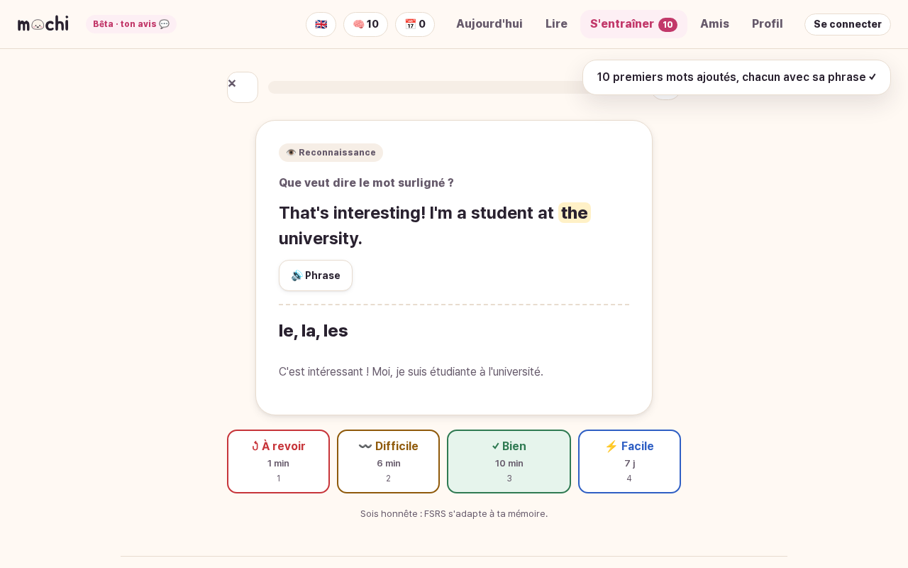

# Mochi 🍡

[](https://github.com/Ishtarsu-1/LearnLanguages/actions/workflows/ci.yml)

**Mochi** est un site pour apprendre l'**anglais** et le **coréen** quand on parle français (le **chinois** et le **russe** sont en test). Chaque jour, une courte séance suit ce que dit la recherche : **lire et écouter** des textes calibrés à ton niveau (~95 % de mots connus), **capturer** les mots inconnus, les **réviser au bon moment** (répétition espacée FSRS), puis **écrire** des phrases corrigées par reformulation.
Pourquoi ça marche, sources à l'appui : page « Pourquoi ça marche » du site (`#/pourquoi`) et [`PEDAGOGIE.md`](PEDAGOGIE.md).

| Accueil | Lecteur | Révision |
|---|---|---|
|  |  |  |

## Fonctionnalités principales

- **Lecteur calibré** : chaque texte affiche le pourcentage de mots que *tu* connais ; touche un mot pour sa traduction et l'ajouter aux révisions, avec sa phrase et son audio.
- **Révisions FSRS** (ts-fsrs) : cartes en contexte, jamais de mots isolés ; anti-interférence (pas deux mots du même groupe le même jour).
- **Écrire** : phrases corrigées par reformulation, par Claude (API) ou Ollama (local, gratuit), avec un correcteur hors ligne en secours.
- **Coréen** : Hangul en 10 jours (sans romanisation ensuite), particules en couleur, registres, clavier coréen intégré. **Chinois** : pinyin et tons. **Russe** : alphabet cyrillique.
- **Vraies voix** neuronales servies et mises en cache par le serveur, plusieurs voix par langue.
- **Amis et défis** coopératifs, **duel en direct** (temps réel), série hebdomadaire bienveillante, quêtes, accessoires de Mochi.
- **Appli installable**, hors ligne, synchronisée sans perte entre appareils.
- **Chaîne de contenu** : plan par fréquence, génération par LLM, annotation automatique, vérifications, relecture humaine dans l'admin ([`CONTENU-PIPELINE.md`](CONTENU-PIPELINE.md)).

Liste complète : [`FEATURES.md`](FEATURES.md). Suite : [`ROADMAP.md`](ROADMAP.md).

## Stack

- **Node.js ≥ 22.5 sans framework** : `server.js` (HTTP natif), base **SQLite** intégrée (`node:sqlite`), deux dépendances (`@anthropic-ai/sdk`, `zod`).
- **Site sans compilation** : scripts classiques, aucun script ni style inline (CSP stricte), jetons de design (`tokens.css`).
- **FSRS** (`ts-fsrs`) pour la répétition espacée.
- **Voix** : Kokoro (anglais, chinois), MeloTTS (coréen), Piper (russe), ou celles du navigateur.
- **IA** : Ollama (local) ou Claude (API Anthropic) ; Kiwi pour l'analyse du coréen.
- Tests : `node` seul pour les suites unitaires et d'API, **Playwright** pour le vrai navigateur.

## Démarrage rapide

```bash
npm install
npm run doctor      # ce que ta machine peut faire tourner (voix, IA), avec les commandes à copier
npm start           # → http://localhost:8000
```

Tout le reste (clé API, Ollama, voix, e-mails, mise en ligne derrière Caddy, sauvegardes) : [`SETUP.md`](SETUP.md). Toutes les commandes : [`commande.md`](commande.md). Mettre en ligne : [`docs/mise-en-ligne.md`](docs/mise-en-ligne.md).

```bash
npm test                 # toutes les suites (site, API, synchro, correcteur, voix, contenu, amis, duel, sauvegarde)
npm run test:e2e         # vrai navigateur : toutes les pages en 1280, 390 et 320 px + un parcours complet
npm run content:check    # vérification du contenu publié
```

### Notifications Discord

Chaque commit est annoncé sur Discord (hook `.githooks/post-commit`). Après un clone :

```bash
git config core.hooksPath .githooks
cp -n .env.example .env   # puis renseigne DISCORD_WEBHOOK_URL dans .env
```

Envoi manuel : `./scripts/notify-discord.sh "message"`.

## Sécurité

- **Mots de passe** : scrypt avec sel aléatoire, comparaison à temps constant (`timingSafeEqual`) ; même temps de réponse pour un e-mail inconnu et un mauvais mot de passe.
- **Sessions** : jeton aléatoire, **seule son empreinte** (SHA-256) est en base ; cookie `HttpOnly`, `SameSite=Lax`, `Secure` en HTTPS ; les autres sessions sont fermées après un changement de mot de passe, toutes après une réinitialisation.
- **Requêtes d'autres sites** : toute requête qui modifie quelque chose doit porter l'en-tête `X-Mochi` (impossible sans pré-vol CORS, jamais autorisé).
- **En-têtes** : Content-Security-Policy stricte **sans `unsafe-inline`** (aucun script ni style inline, aucun domaine externe), `frame-ancestors 'none'`, `Permissions-Policy`, `Cross-Origin-Opener-Policy`, `Referrer-Policy`, HSTS en HTTPS.
- **Vraie IP derrière un proxy** : `X-Forwarded-For` (ou `CF-Connecting-IP`) lu **seulement** depuis un proxy de confiance (`TRUST_PROXY`, `TRUST_CF`) ; IPv6 regroupées par /64.
- **Limitation des tentatives persistante** (SQLite, survit aux redémarrages) : freinage progressif par IP et par compte (connexion, inscription, mot de passe oublié, correcteur, voix, formulaire d'avis, amis).
- **Fichiers servis par liste blanche** (aucun chemin construit depuis la requête) ; identifiants de contenu validés par expression régulière ; écriture limitée au dossier `content/` dans l'admin.
- **Commandes système** : `execFile` à arguments fixes (jamais de shell) dans `npm run doctor` et l'admin ; délais de 5 s.
- **Correcteur IA** : quota par compte (30/jour), plafond global quotidien, cache des réponses ; le texte de l'apprenant est traité comme une donnée, jamais comme une instruction.
- **Données personnelles** (RGPD) : export JSON, suppression du compte (tout part en cascade), données temporaires purgées toutes les heures, pages légales et sous-traitants listés ; les mesures de la bêta sont agrégées et anonymes.
- **Sauvegardes** : copie cohérente vérifiée (`npm run backup`), restauration testée automatiquement, Litestream vers R2 en production.

Une faille ? Écris-moi plutôt que d'ouvrir une issue publique (adresse dans les mentions légales du site).

## Licences et crédits

- **Code** : pas encore de licence libre (tous droits réservés par l'auteur).
- **Contenu** (textes, livres, histoires et lexique de Mochi) : [CC BY-NC 4.0](https://creativecommons.org/licenses/by-nc/4.0/deed.fr) depuis le 20 novembre 2026 (pas d'usage commercial sans accord ; les versions diffusées avant restent en CC BY 4.0). La liste de fréquences anglaise `content/freq/en.tsv`, dérivée de wordfreq, reste en CC BY-SA 4.0.
- **Voix** : Kokoro (Apache 2.0), MeloTTS (MIT), Piper (moteur MIT ; voix russes « denis » et « dmitri » en CC0, base Hi-Fi TTS en CC BY 4.0 ; voir `SETUP.md`).
- **Polices** : Pretendard, Jua, Fredoka (SIL Open Font License 1.1). **FSRS** : ts-fsrs (MIT).
- **Listes de vocabulaire** : 국립국어원 (공공누리 type 1), wordfreq (CC BY-SA 4.0), simplemma (MIT). **Analyseur coréen** : Kiwi (LGPL-3.0).

Détail : page « Crédits » du site (`#/legal/credits`).
